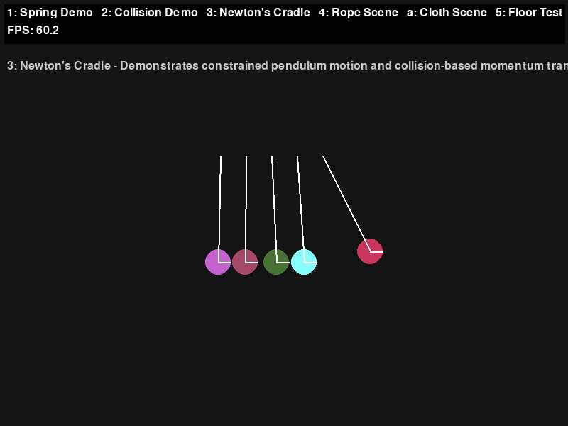
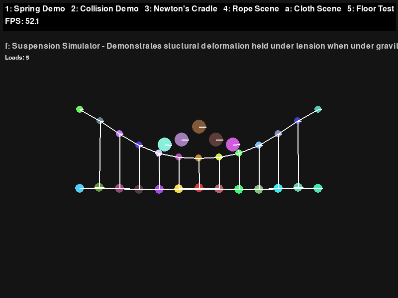
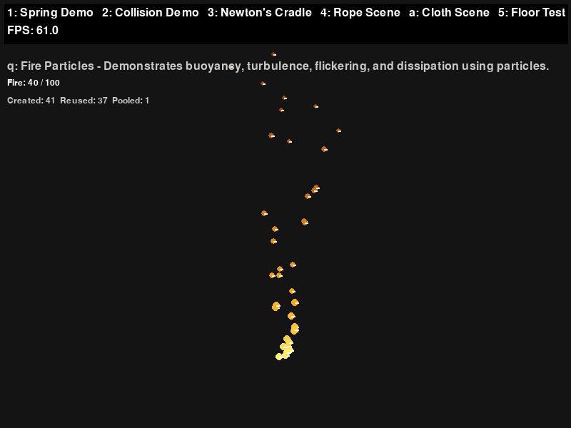

# Physics-Simulation-Lab

This passion project is a custom 2D physics simulation engine built from scrtach using only Python and pygame for visulaisation.

Physics Simulation Lab explores basic mechanics, engineering structure simulations,
soft-body mechanics, particle systems, fluid behaviour and electromagnetic
interactions through a variety of interactive simulations.

The project combines a custom rigid-body physics engine, constraint solver,
collision detection system and rendering framework, creating a wide range
of physics demonstrations within a single application.

## Features

### Physics Engine

- Custom 2D rigid-body physics engine.
- Vector mathematics and rotational dynamics.
- Gravity, force integration and damping.
- Springs and constraint-based systems.
- XPBD compliance for flexible constraints.
- Mass-weighted constraint solving.
- Substepping for improved numerical stability.

### Collision Detection and Resolution

- Circle-to-circle collision detection.
- Restitution and friction.
- Rotational collision impulses.
- Static rigid bodies.
- Spatial hash grid for broad-phase collision detection.
- Continuous collision detection (CCD).
- Swept collision tests using a dynamic AABB tree.

### Stability and Performance

- Position-based velocity reconstruction.
- Constraint batching.
- Collision stabilization.
- Body sleeping and wake propagation.
- Island-based sleeping.
- Body pooling and object recycling.
- Physics profiling and benchmark scenes.

### Rendering and Debugging

- Camera with zoom and pan.
- Real-time debug visualizations.
- Collision normals and velocity vectors.
- Force vectors and bounding boxes.
- Sleeping-state visualization.
- Screenshot capture.
- MP4 recording.

### Interactive Tools

- Interactive scene switching.
- Body editor.
- Physics parameter adjustments.
- Scene resetting.
- Frame stepping.
- Performance profiling.

## Demonstrations

Physics Simulation Lab contains demonstrations covering several
areas of physics and engineering.

### Classical Mechanics

| Simulation | Description |
|---|---|
| Spring Demo | Spring forces, gravity and damping |
| Collision Demo | Collisions, restitution and friction |
| Newton's Cradle | Momentum transfer through collisions |
| Rope | Distance-constrained rope systems |
| Simple Pendulum | Gravitational pendulum motion |
| Double Pendulum | Coupled pendulum dynamics |
| Projectile Motion | Projectile trajectories under gravity |
| Inclined Plane | Motion and friction on an inclined surface |
| Atwood Machine | Coupled motion of unequal masses |
| Orbital Mechanics | Gravitational attraction and orbital motion |
| Elastic vs Inelastic | Effects of restitution on collisions |

### Structural Engineering

| Simulation | Description |
|---|---|
| Cloth | Deformable constraint-based cloth |
| Bridge | Structural deformation |
| Truss | Triangular structural systems |
| Suspension Bridge | Suspension-based structural simulation |
| Beam Bending | Deformation under loading |

### Soft Bodies

| Simulation | Description |
|---|---|
| Soft Cube | Deformable particle-based structure |
| Jelly Ball | Deformable spherical structure |
| Soft Bridge | Flexible bridge structure |
| Pressure Simulation | Internal pressure and volume preservation |

### Particles and Fluids

| Simulation | Description |
|---|---|
| Particle Fountain | Continuously emitted particles |
| Water | Particle-based fluid simulation |
| Sand | Granular particle behaviour |
| Smoke | Buoyancy and turbulent particle motion |
| Fire | Particle-based fire effects |

### Advanced Demonstrations

| Simulation | Description |
|---|---|
| Wind | External forces on flexible structures |
| Magnetism | Magnetic attraction and repulsion |
| Electric Fields | Electric forces and field interactions |
| Dominoes | Collision propagation |
| Ragdoll | Articulated rigid-body structures |

### Development and Benchmarking

- Interactive Body Editor
- Body Benchmark
- Collision Benchmark
- Constraint Benchmark

## Physics Engine Architecture

The project is divided into three main components.

### Physics

Responsible for the mathematical and physical simulation.

Includes:
- Vector mathematics.
- Rigid-body dynamics.
- Force and velocity integration.
- Springs and constraints.
- Collision detection and resolution.
- Spatial partitioning.
- Sleeping and performance optimisation.

### Rendering

Responsible for converting the simulated world into visual output.

Includes:
- Body and constraint rendering.
- Camera transformations.
- Debug visualizations.
- Screenshot capture.
- Video recording.

### Scenes

Each demonstration is implemented as an independent scene.

Scenes configure their own physics worlds and can introduce
additional forces, constraints, interactions and simulation rules.

A central scene manager handles scene registration, switching
and resetting.

## Controls

### Scene Selection

Press the corresponding key to switch simulations.

| Key | Scene |
|---|---|
| 1 | Spring Demo |
| 2 | Collision Demo |
| 3 | Newton's Cradle |
| 4 | Rope |
| 5 | Floor Test |
| 6 | Simple Pendulum |
| 7 | Double Pendulum |
| 8 | Projectile Motion |
| 9 | Inclined Plane |
| 0 | Atwood Machine |
| A | Cloth |
| B | Orbital Mechanics |
| C | Elastic vs Inelastic |
| D | Bridge |
| E | Truss |
| F | Suspension |
| G | Beam Bending |
| I | Soft Cube |
| J | Jelly Ball |
| K | Soft Bridge |
| L | Pressure |
| M | Particle Fountain |
| N | Water |
| O | Sand |
| P | Smoke |
| Q | Fire |
| S | Wind |
| T | Magnetism |
| U | Electric Fields |
| V | Dominoes |
| W | Ragdoll |
| X | Body Benchmark |
| Y | Body Editor |
| Z | Collision Benchmark |
| F12 | Constraint Benchmark |

### General Controls

| Key | Action |
|---|---|
| R | Reset current scene |
| H | Toggle current scene help |
| F10 | Toggle all scene help |
| F1 | Toggle debug rendering |
| F2 | Toggle collision grid |
| F3 | Toggle collision normals |
| F4 | Toggle velocity vectors |
| F5 | Toggle force vectors |
| F6 | Toggle bounding boxes |
| F7 | Toggle sleeping visualization |
| F8 | Take screenshot |
| F9 | Start/stop video recording |
| F11 | Toggle physics profiler |
| = | Zoom in |
| - | Zoom out |
| Arrow Keys | Move camera |

Individual scenes may provide additional mouse interactions.

## Installation

### Requirements

- Python
- pip

### Clone the Repository

git clone https://github.com/Furious125X/Physics-Simulation-Lab.git
cd Physics-Simulation-Lab

## Project Structure

Physics-Simulation-Lab/
│
├── physics/
│   ├── aabb_tree.py
│   ├── body.py
│   ├── body_pool.py
│   ├── constraints.py
│   ├── grid.py
│   ├── profiler.py
│   ├── spring.py
│   ├── vector.py
│   └── world.py
│
├── render/
│   ├── camera.py
│   └── renderer.py
│
├── scenes/
│   ├── Individual simulation scenes
│   ├── base_scene.py
│   ├── scene_config.py
│   └── scene_manager.py
│
├── recordings/
├── screenshots/
│
├── main.py
├── README.md
└── requirements.txt

## Screenshots

### Newton's Cradle

### Bridge Simulation

### Fire Simulation

